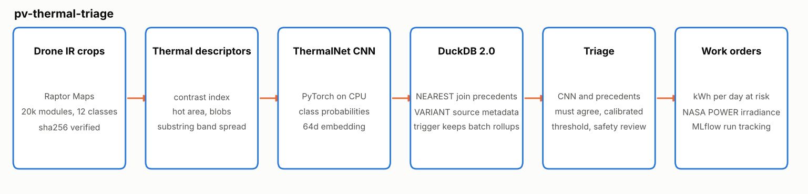
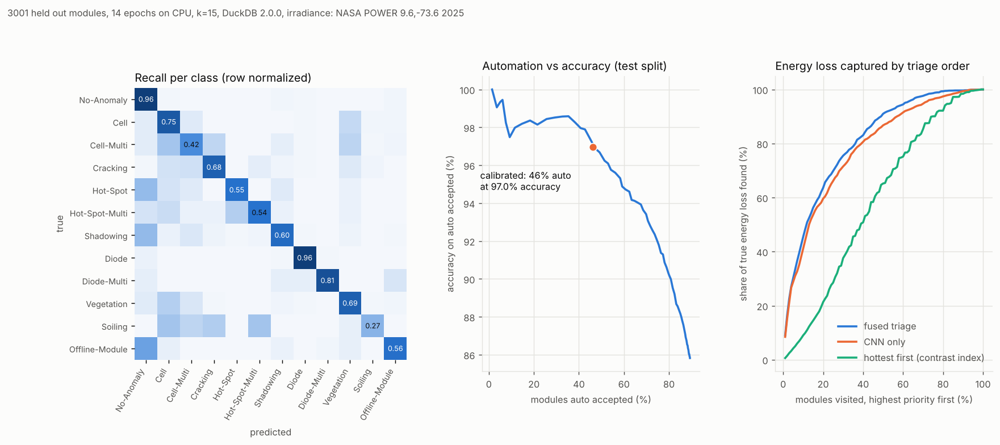

# pv-thermal-triage

Thermal triage for solar PV drone inspections. It reads infrared crops of
individual modules, classifies 11 kinds of anomaly, finds the most similar
modules that were already labelled, decides which findings can be accepted
automatically and which need a person, and ranks the work orders by the energy
they put at risk.

Everything runs on a laptop CPU with public data and no API keys.



## The problem

A drone survey of a utility scale solar plant produces tens of thousands of
module level thermal crops. Most are healthy. The rest range from a single warm
cell that costs almost nothing to a module that is completely offline or a
bypass diode that has taken a third of the module out of production. O and M
teams need three answers fast:

1. What is wrong with each module, and how sure are we?
2. Which findings can go straight into the work order system and which need an
   engineer to look at them?
3. Where should the crew go first?

Most pipelines stop at the first answer and rank by temperature difference.
This project covers all three, and measures each one.

## Why now

* **DuckDB 2.0.0 LTS shipped on 21 October 2026** with NEAREST joins for top k
  similarity search in SQL, statement level triggers with transition tables and
  a shredded VARIANT type. This project uses all three in a real workflow and
  reports where they help and where they do not yet
  ([announcement](https://duckdb.org/2026/10/21/announcing-duckdb-200)).
* **Thermal understanding is moving from pixels to decisions.** On 17 September
  2026 Raytron presented an infrared vision language model aimed at electrical
  inspection and gas detection at the edge
  ([PR Newswire](https://www.prnewswire.com/news-releases/raytron-unveils-infrared-vision-language-model-at-cioe-2026-advancing-thermal-imaging-from-perception-to-understanding-302881706.html)).
* **Autonomous drone inspection of PV is an active research topic.** On
  3 September 2026 pv magazine covered a Polish and Spanish team that combined
  radiometric thermal and multispectral cameras on a drone and reported a macro
  F1 of 0.904 on their own 5 class dataset
  ([pv magazine](https://www.pv-magazine.com/2026/09/03/ai-powered-drone-system-for-autonomous-pv-fault-detection/)).
  Their classes and data differ from the ones used here, so the numbers are not
  comparable, but the gap between "a classifier" and "a decision a crew can act
  on" is the same.

## Data

| Source | What | License | Downloaded |
|---|---|---|---|
| [Raptor Maps InfraredSolarModules](https://github.com/RaptorMaps/InfraredSolarModules) | 20,000 real infrared module crops (24 x 40 px), 12 classes, published at the ICLR 2020 AI for Earth Sciences workshop | MIT | 2026-10-22 |
| [NASA POWER daily API](https://power.larc.nasa.gov/) | 2025 daily all sky surface irradiance for La Loma, Cesar, Colombia (9.6 N, 73.6 W) | NASA open data, no key | 2026-10-22 |

`pvtriage download` fetches the 15 MB zip and checks its SHA256 before
extracting. The repo only carries a stratified sample of 240 crops (20 per
class) and one year of NASA POWER data in `data/sample/`, used by tests and CI.

The crops are 8 bit renders, not radiometric temperatures, so everything thermal
in this project is relative to the module (contrast index, hot area, substring
band spread). The site is used only to turn loss fractions into kWh; the
imagery does not come from that site.

## How it works

1. **Ingest.** Load crops and metadata, stratified 70/15/15 split with a fixed
   seed. Raw metadata goes into a DuckDB `VARIANT` column.
2. **Thermal descriptors.** Interpretable features per crop: median and p99
   level, contrast index, hot area fraction, number of hot blobs, and the spread
   between the warmest and coolest third of the module, which is how a bypass
   diode fault shows up. They explain each work order and feed a baseline.
3. **ThermalNet.** A small PyTorch CNN with two input channels (absolute level
   and level relative to the module median), class weighted loss and flips as
   augmentation. It outputs class probabilities and a 64 dimensional embedding.
4. **Precedents in DuckDB 2.0.** Training embeddings are the labelled reference
   set. For every new crop a `NEAREST 15 BY SIMILARITY array_cosine_similarity`
   join returns the most similar labelled modules, aggregated into a similarity
   weighted vote.
5. **Triage.** CNN and precedent vote are averaged. A finding is auto accepted
   only when both agree on the class, the fused confidence clears a threshold
   calibrated on validation for 97 percent accuracy, and the module has less
   than 25 percent probability of a safety relevant class. Everything else goes
   to review, and the nearest labelled precedents of any module can be pulled
   with one NEAREST query for the engineer to compare.
6. **Work orders.** Expected kWh per day at risk is the fused probability times
   a per class loss fraction times the daily output of a healthy module from
   NASA POWER irradiance. Safety findings come first, then energy.
7. **Rollups and tracking.** Findings arrive in batches of 500. A DuckDB trigger
   merges each batch into `batch_rollup`, and the run asserts the trigger totals
   equal a full rescan. MLflow logs parameters, per epoch metrics and artifacts
   to a local SQLite store.

Design decisions are in [docs](docs/):
[ADR 001 DuckDB 2.0](docs/adr-001-duckdb-2-for-precedents-and-rollups.md),
[ADR 002 two signal auto accept](docs/adr-002-two-signal-auto-accept.md),
[ADR 003 energy weighted priority](docs/adr-003-energy-weighted-priority.md).

## Results

Full run on the 20,000 module dataset, 3,001 held out test modules, 14 epochs,
2 CPU threads, seed 7, DuckDB 2.0.0, PyTorch 2.14 CPU. Training takes 7 to 11
minutes and the whole run 9 to 12 minutes on a 2 vCPU machine. I ran it three
times in a row: every quality metric below was identical across runs, only the
timings moved. Numbers come from `reports/metrics.json` and are reproducible
with `pvtriage run`.



**Classification (12 classes, test split)**

| Method | Accuracy | Macro F1 | Anomaly recall | Anomaly precision |
|---|---|---|---|---|
| Thermal descriptors + gradient boosting | 0.453 | 0.301 | 0.913 | 0.655 |
| ThermalNet CNN only | 0.796 | 0.654 | 0.931 | 0.919 |
| DuckDB precedents only (k=15) | 0.816 | 0.667 | 0.903 | 0.971 |
| **Fused (used for triage)** | **0.818** | **0.679** | 0.911 | **0.961** |

Bypass diode faults (F1 0.95) and multiple diodes (0.86) are easy. Soiling
(0.36) and multi cell hot spots (0.48) are the hard classes, and they are
mostly confused with neighbouring anomaly classes rather than with healthy
modules.

**Triage**

* 46.2 percent of test modules were auto accepted, at 97.0 percent accuracy.
  The threshold was set on validation (46.0 percent at 97.0 percent) and held on
  test.
* The other 53.8 percent go to review. The model is right on 68.8 percent of
  those, which is exactly why they should not be automated.
* 22 of 1,501 real anomalies (1.5 percent) were auto accepted as healthy. They
  carry 13.2 of 489.8 kWh per day of true loss (2.7 percent). This is the number
  to watch when lowering the bar.
* 451 modules were sent to review because of the safety rule.

**Where to send the crew first** (share of the true energy loss found)

| Ranking | Top 10 percent of modules | Top 50 percent |
|---|---|---|
| Hottest first (contrast index) | 9.0 percent | 65.4 percent |
| CNN only | 41.1 percent | 87.1 percent |
| **Fused triage** | **45.4 percent** | **91.5 percent** |

Ranking by thermal contrast alone is close to random for energy because the
most expensive faults (offline modules, diodes) are warm everywhere rather than
in one bright spot.

**DuckDB 2.0**

* NEAREST join, 3,001 queries against 13,999 reference embeddings of 64
  dimensions: about 17 s (16.9 to 18.2 s across runs). The numpy brute force
  reference that runs next to it took 4.6 to 7.8 s. Both returned the same top
  class for every query.
* `APPROX NEAREST` gave the same answers and no speed up without an index.
* The batch rollup maintained by the trigger matched a full rescan after all
  7 batches.

## Run it

```bash
python -m venv .venv && source .venv/bin/activate
make install          # CPU wheels for PyTorch, then the package with dev tools
make data             # downloads and verifies the dataset into data/raw
make run              # trains, indexes, triages, writes reports/
make test             # unit tests and a tiny end to end run
make smoke            # 2 epoch run on the bundled sample, used in CI
```

Outputs in `reports/`: `metrics.json`, `summary.txt`, `work_orders.csv` (top
50 with precedent class, decision and action), `rollups.json`, `results.png`,
`pvtriage.duckdb` and the MLflow store (`mlflow ui --backend-store-uri
sqlite:///reports/mlflow.db`).

Settings are environment variables with the `PVT_` prefix, see `.env.example`.
`--offline` skips NASA POWER and uses the bundled year.

## Repository layout

```
pvtriage/        package: config, data, thermal, model, store, triage, irradiance, report, pipeline, cli
tests/           unit tests per module plus an end to end test on the sample
data/sample/     240 crops in images/, their metadata and one year of NASA POWER data
docs/            architecture and results figures, ADRs
.github/         CI: ruff, pytest, smoke run
```

## Limitations

* The crops are 24 x 40 px and not radiometric, so no absolute temperature
  can be estimated. With radiometric frames the contrast index becomes a real
  delta T and could follow IEC TS 62446-3 severity bands.
* Loss fractions per class are planning assumptions in `config.py`, not
  measurements. Absolute kWh numbers are estimates (the fused estimate is 21
  percent above the class based truth); the ranking comparison is fair because
  every method uses the same fractions.
* Calibration is empirical on one validation split. A conformal procedure would
  give a finite sample guarantee on the auto accept error rate.
* The precedent index is exact brute force. For a fleet with millions of
  modules I would partition by site and survey, or move to an ANN index.
* No module geometry or neighbours. Offline modules and shadowing are much
  easier to separate when the crop is compared with adjacent modules in the
  same string.

## License

MIT, see [LICENSE](LICENSE). The dataset keeps its own MIT license from Raptor
Maps.
